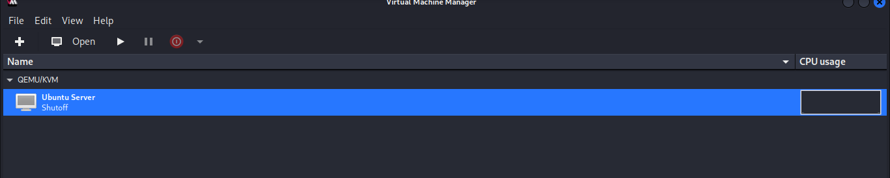
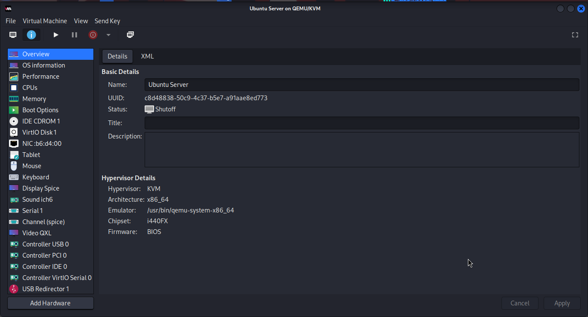
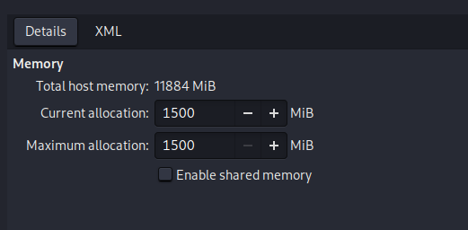
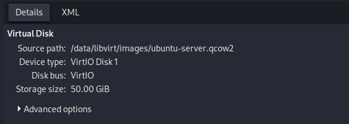
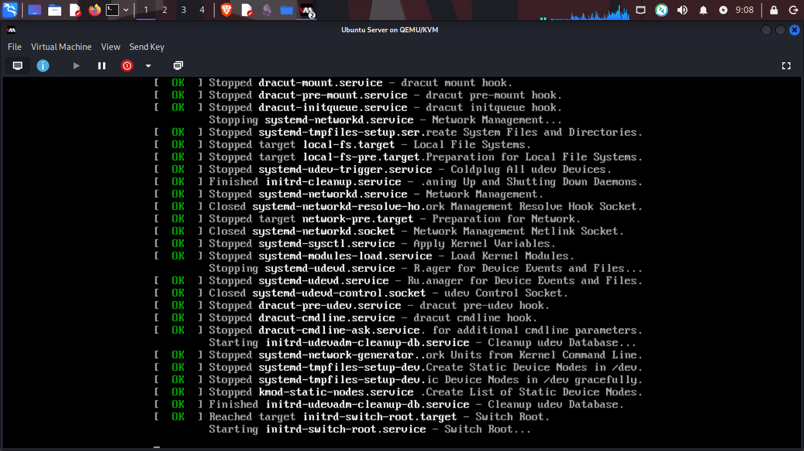
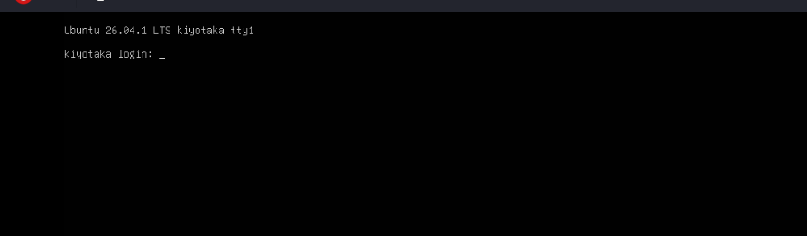

# Case Study: Linux VM Lab Setup

## Summary

| Item | Detail |
| --- | --- |
| Type | Course case study, hands-on lab record |
| Module | 02: Download, Install and Configure |
| Platform | Virt-Manager (KVM/QEMU) on a Kali Linux host |
| Linux release | Ubuntu Server 26.04.1 LTS |
| VM resources | 1.5 GB RAM, 2 CPU cores, 50 GB disk |
| Login method | Username and password (sample user `student-01`) |

## Contents

1. [Plan the lab](#1-plan-the-lab)
2. [Install Linux](#2-install-linux)
3. [Test the lab](#3-test-the-lab)
4. [Test a recovery step](#4-test-a-recovery-step)
5. [Lab record](#5-lab-record)

## 1. Plan the lab

My main computer is not a high-end machine, so I run Kali Linux on it and use Virt-Manager with KVM to run other systems. The VM is my practice lab for system administration.

**Host computer**

| Item | Value |
| --- | --- |
| RAM | 12 GB DDR4 (8 GB + 4 GB) |
| Processor | Intel Core i5, 2.6 GHz, 4 cores |
| Boot disk | 128 GB SSD |
| Storage disk | 500 GB external HDD (also holds the VM) |

**Linux image:** Ubuntu Server 26.04.1 LTS ISO.

**What I gave the VM**

| Item | Amount | Why |
| --- | --- | --- |
| RAM | 1.5 GB | Enough for a server, and leaves most of the 12 GB for the host |
| CPU | 2 cores | Leaves 2 cores for the host |
| Storage | 50 GB | Stored on the HDD in its own storage pool, so the small SSD stays free |

*The VM in Virt-Manager.*

*VM details: KVM, x86_64, BIOS firmware.*

*Memory: 1500 MiB given to the VM, out of 11884 MiB on the host.*

*Virtual disk: 50 GiB qcow2 file on the HDD, VirtIO bus.*

## 2. Install Linux

| Item | Choice |
| --- | --- |
| Where I created it | Virt-Manager (KVM/QEMU) |
| Disk | 50 GiB VirtIO disk, qcow2 file |
| User account | Normal user, sample name `student-01` |
| After install | Removed the ISO from the VM |

*Ubuntu Server starting up.*

*Login prompt. Linux starts and the lab works.*

## 3. Test the lab

| Check | Result |
| --- | --- |
| VM starts and shows the login prompt | Worked |
| Login with the test user | Worked, Ubuntu is running |
| Network type | Bridge |
| Linux release | Ubuntu 26.04.1 LTS, shown in the login banner |

**Problem and fix:** the VM did not boot at first. I checked the boot settings, fixed the boot order, and restarted it.

**Host vs guest**

| | Host | Guest |
| --- | --- | --- |
| What it is | My physical computer | The Ubuntu Server VM |
| System | Kali Linux | Ubuntu Server 26.04.1 LTS |
| Role | Gives the RAM, CPU, and storage | Runs as a separate system inside the host |

## 4. Test a recovery step

Status: **plan only, not tested yet.**

| Step | Plan |
| --- | --- |
| Recovery point | Take a snapshot in Virt-Manager |
| Small change | Create a test folder |
| Undo | Restore the snapshot and check the folder is gone |
| Separate backup | Copy the VM disk file to a different drive, not the HDD that holds the VM |

## 5. Lab record

| Item | Record |
| --- | --- |
| Platform | Virt-Manager (KVM/QEMU) |
| Linux release | Ubuntu Server 26.04.1 LTS |
| Resources | 1.5 GB RAM, 2 CPU cores, 50 GB disk |
| VM name | ubuntu-server-lab |
| Login method | Username and password (sample user `student-01`) |
| Test results | VM boots, login works, bridge network in use |
| One fixed problem | VM did not boot at first. Fixed the boot order. |
| Recovery limits | A snapshot only undoes changes inside the VM. It is stored with the VM disk, so it does not protect me if the drive fails. A separate backup on another drive does. |

Sample names are used. No passwords or keys are included.

## What I Learned

- A VM lets me install and use Linux without replacing my main operating system
- A snapshot can undo changes, but it is not a backup
